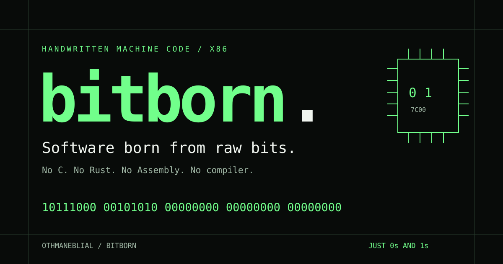
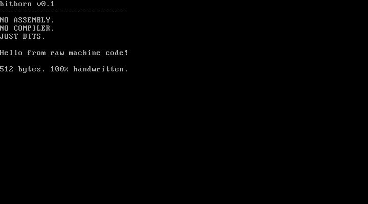

# bitborn

### Software born from raw bits.

**No C. No Rust. No Assembly. No compiler. Just 0s and 1s.**

[](https://github.com/OthmaneBlial/bitborn/actions/workflows/test.yml)
[](https://github.com/OthmaneBlial/bitborn/actions/workflows/pages.yml)
[](https://github.com/OthmaneBlial/bitborn/releases/latest)
[](LICENSE)

**[Explore the live website →](https://othmaneblial.github.io/bitborn/)** ·
[Documentation](https://othmaneblial.github.io/bitborn/docs.html) ·
[Download the 512-byte image](https://othmaneblial.github.io/bitborn/downloads/boot.img)

What if you could build a real bootable computer program without writing a
single instruction in a programming language?

bitborn explores that question by encoding machine instructions directly as
binary digits. Every opcode. Every operand. Every branch displacement. No
assembler translates the target code: we author the bytes themselves.

**A real 512-byte BIOS boot program, fourteen reviewed examples, four byte tools,
an editable boot builder, a visual CPU lab, and 20 binary challenges.** This is an educational experiment, not a
production operating system.


*Actual QEMU/SeaBIOS boot, not a simulated terminal. [Capture provenance](assets/boot-recording.json).*

## Start with the real machine

You need **Python 3.10+, Make and QEMU**. On macOS: `brew install qemu`.
On Ubuntu: `sudo apt-get install python3 make qemu-system-x86`.

```sh
git clone https://github.com/OthmaneBlial/bitborn.git
cd bitborn
make test
make run
```

`make run` boots the image in a graphical QEMU window and mirrors its text to
the serial terminal. `make test` uses headless QEMU and checks real guest behavior.
The BIOS examples also work under TCG emulation on Apple Silicon. Linux ELF
examples require a **Linux x86-64 kernel**; macOS skips their native test and
Ubuntu CI executes all six.

## Roadmap — visible progress

Updated **2026-10-12** after each verified milestone. See [ROADMAP.md](ROADMAP.md)
for exact evidence and remaining gates.

| Milestone | Progress |
| --- | --- |
| 512-byte handwritten boot program and four byte tools | ✅ QEMU-tested, public |
| Linux exit, arithmetic, text, loops and comparisons | ✅ Native execution passed in Linux CI |
| BIOS keyboard and direct VGA memory writes | ✅ QEMU-tested |
| Multi-sector loader and interactive monitor | ✅ QEMU-tested: help, clear, about, reboot, peek |
| Ten example guides and complete byte tables | ✅ Documented, with actual execution checks |
| Real boot screenshot/GIF and architecture tutorial | ✅ Captured from QEMU and reproducible |
| Interactive `.io` website and mobile browser checks | ✅ Live; HTTPS assets and Chrome interactions verified |
| Public v0.1.0 images, source and checksums | ✅ Published; downloaded artifacts and checksums verified |
| [v0.1.1 host-tool patch](https://github.com/OthmaneBlial/bitborn/releases/tag/v0.1.1) | ✅ Published; comment/failed-write checks and downloaded artifacts verified |
| Shared CPU model: flags, calls, stack and segmented memory | ✅ Locally verified; modern PUSH SP semantics checked in real QEMU |
| Full editable 512-byte boot-sector builder | ✅ Chrome-tested; exact downloaded image/source boot the one-bit edit in QEMU |
| Visual CPU lab: registers, flags, stack, memory and breakpoints | ✅ Five literal teaching programs and Chrome controls verified |
| 20 challenges across four levels | ✅ All solutions pass model and QEMU goals; seeds fail; local progress and sharing tested |
| Eight dedicated `.io` routes and a size-comparison lab | ✅ Public; expanded Linux CI and live builder checks passed |
| Original 12-byte exit versus 8-byte alternative | ✅ Both return 42 in Linux CI; 132→128-byte ELF sizes, no speed claim |
| New browser GIFs, showcase and contributor issue forms | ✅ Genuine captured states with provenance; contributor files checked |
| Native shell and separately authored disk app | ✅ Nine commands, real RAM/register snapshots, checked disk load and repeated return in QEMU |
| 32-bit protected mode and software interrupt | ✅ GDT, flat memory, IDT gate and IRETD verified in QEMU; native captures recorded |
| Packaging and boundary correctness | ✅ Source aliases/collisions/corrupt derived files rejected; 16-bit IP wrap tested |
| Paging, exception/hardware interrupt handling and physical hardware | Future research; no working claim |

## From text bits to CPU instructions

```text
10111000 00101010 00000000
   B8       2A       00
```

In 16-bit real mode, this means `MOV AX,42`: one opcode byte followed by the
little-endian immediate operand. The instruction name here is an explanation,
never an input to a code generator. In a 32-bit operand-size context, the same
opcode consumes four immediate bytes. **Execution mode matters.**

The `.bits` file is human-readable notation; `bitpack` removes comments and
whitespace and turns each eight-digit token into exactly one byte. BIOS loads
those bytes at physical `7C00`. The x86 CPU decodes and executes them.

```sh
./tools/bitpack boot/boot.bits boot.img
./tools/bitinspect boot.img --annotations boot/annotations.json
./tools/bitverify boot.img --size 512 --bios
./tools/bitdiff build/boot.img boot.img
```

| Tool | What it does |
| --- | --- |
| `bitpack` | Strictly packs binary byte tokens; useful source-line errors |
| `bitinspect` | Offsets, binary, hex and known annotated instruction boundaries |
| `bitverify` | Sizes, BIOS signature, reviewed hashes, annotations, source audit and reproduction |
| `bitdiff` | Marks each changed bit, including added or removed bytes |

The host tools are Python. The browser explorer is JavaScript. The **target
machine instructions** are authored directly in `.bits`. Packaging gallery
payloads adds non-executable zero fill, BIOS signatures or ELF headers; it never
generates an instruction. The main boot source already contains all 512 bytes.

## Inside one sector



The program normalizes CS, sets data/stack segments, selects VGA text mode,
initializes COM1 to 115200 baud/8N1, and prints the exact greeting to both outputs.
It then disables interrupts and enters a controlled halt loop.

| Region | Bytes |
| --- | --- |
| Handwritten instructions | 91 |
| Literal greeting, line breaks and NUL | 148 |
| Explicit zero padding | 271 |
| BIOS signature `55 AA` | 2 |
| **Total** | **512** |

[Read the canonical source](boot/boot.bits) · [Every boot byte explained](examples/boot-sector/bytes.md) ·
[Architecture](docs/architecture/README.md) · [Encoding guide](docs/instruction-encoding/README.md)

## The example collection

| Example | Actual result | Environment |
| --- | --- | --- |
| [Return an exit code](examples/exit-code/README.md) | Exit 42 | Linux x86-64 |
| [Arithmetic](examples/arithmetic/README.md) | 6×7 → exit 42 | Linux x86-64 |
| [Print text](examples/print-text/README.md) | Hello from raw bits! | Linux x86-64 |
| [Loop and count](examples/loop-count/README.md) | Five iterations → exit 5 | Linux x86-64 |
| [Compare values](examples/compare-values/README.md) | Equality branch → exit 42 | Linux x86-64 |
| [Keyboard input](examples/keyboard/README.md) | Real key echoed to VGA/COM1 | BIOS |
| [VGA memory](examples/vga/README.md) | Bright green B at B8000 | BIOS |
| [512-byte boot sector](examples/boot-sector/README.md) | Greeting and halt | BIOS |
| [Interactive monitor](examples/monitor/README.md) | Five exact commands and edited input | BIOS |
| [Disk reads](examples/disk-read/README.md) | Load and execute additional sectors | BIOS |
| [Eight-byte exit](examples/exit-code-small/README.md) | Same exit 42; smaller payload, more stack traffic | Linux x86-64 |
| [Binary shell](examples/shell/README.md) | Nine commands, real memory, register snapshot and disk app | BIOS |
| [Returning disk app](examples/shell-app/README.md) | Computes 7×6, stores 2A in RAM, returns to shell | BIOS payload |
| [Protected mode](examples/protected-mode/README.md) | 32-bit flat memory, IDT software interrupt and IRETD | BIOS → protected mode |

Each guide links its canonical source, per-byte table, generated binary path,
expected behavior and automated test. `make build` produces the artifacts.
The six ELF programs consist of the unchanged payload plus 120-byte host-packed
headers; they use Linux syscalls with no runtime library or linker.

```sh
qemu-system-i386 -drive file=build/monitor.img,format=raw,if=floppy -boot a -serial stdio
```

Type in the QEMU display and press Enter. The monitor supports exact lowercase
`help`, `clear`, `about`, `reboot` and `peek`; a 15-character input bound and
Backspace editing. `peek` loads the actual byte at physical `7C00`. The monitor
and disk-read images use a separately handwritten loader and two padded sectors.

The new shell adds `dump`, `regs`, `write`, `read` and `run` alongside help,
about, clear and reboot. Its five-sector disk loads a separately authored app
at `9000`; BIOS carry errors stop the launch. `regs` samples the actual CPU at
handler entry. The memory experiment and app calculation are checked against
guest RAM. The separate protected-mode target enters 32-bit ring zero, loads a
GDT and one software-interrupt gate, then verifies memory and interrupt return.
Neither experiment supplies paging, general exception handling or a full OS.

## Explore and contribute

Start with the [Boot Sector Builder](https://othmaneblial.github.io/bitborn/boot-builder/):
all 512 bytes are editable, current decoding explains fields, and `.bits`/`.img`
exports preserve your exact bytes. Change offset 176 from `01001000` to
`01101000`, then boot the downloaded image: “Hello” becomes “hello”.

The [CPU Lab](https://othmaneblial.github.io/bitborn/cpu-lab/) shows all modeled
16-bit registers, flags, changed register bits, stack and memory. Step, run,
pause, adjust speed, set breakpoints or inspect a bounded literal program.
The [20 challenges](https://othmaneblial.github.io/bitborn/challenges/) provide
four difficulty levels, hints, semantic goals, share links and progress stored
only in your browser. Every reviewed solution also runs in QEMU; success is
based on the behavior goals rather than equality with one answer.

Browser execution is a **bounded educational model**, with a 4,096-step ceiling,
1 MiB modeled memory and explicit unsupported-encoding errors. It does not run
native browser code. `make site-test` verifies source hashes, execution and links.
[Learning paths](https://othmaneblial.github.io/bitborn/learn/),
[architecture](https://othmaneblial.github.io/bitborn/architecture/),
[examples](https://othmaneblial.github.io/bitborn/examples/) and the
[live roadmap](https://othmaneblial.github.io/bitborn/roadmap/) have dedicated pages.
The roadmap and homepage progress feed are rebuilt from the table above.

```sh
npm ci                         # development-only browser test dependency
npx playwright install chromium
npm run test:browser            # real Chrome interactions and mobile layouts
npx playwright install firefox webkit
npm run test:cross-browser      # Firefox/WebKit interactions and exact downloads
python3 tools/verify_browser_export.py # actual QEMU boot of the browser download
python3 -m http.server 8000 --directory site
```

[Beginner tutorial](docs/tutorials/from-bits-to-boot.md) · [Contributing](CONTRIBUTING.md) ·
[Reproducible showcase](SHOWCASE.md) · [Good first contributions](GOOD_FIRST_ISSUES.md) ·
[Changelog](CHANGELOG.md) · [Roadmap](ROADMAP.md) ·
[v0.1.0 release](https://github.com/OthmaneBlial/bitborn/releases/tag/v0.1.0)

## What the tests establish

Independent encoding assertions and branch checks supplement reviewed SHA-256
hashes. QEMU tests verify exact serial output, halt state, actual VGA/loaded-disk
memory, every monitor command, editing, buffer bounds, reboot, and a forced BIOS
disk-read failure. Native Linux CI runs all six ELF payloads. Browser tests
exercise bit edits, opcode changes, unsupported encodings, signature inspection,
full simulated boot, copy controls, reduced-motion mode and mobile layouts.
New checks cover every challenge's positive and negative case, exact bit-edit
budgets, local storage failures, downloaded image/source identity, lab calls and
flags, live memory fetch, breakpoints, and source-derived roadmap rendering.

Hashes prove byte identity, not correctness or authorship. QEMU proves emulated
behavior, not physical-hardware support. CI status is linked above.

## FAQ and limits

**Isn't machine code just Assembly?** Assembly is a symbolic language; an
assembler encodes it. Here the bytes themselves are the source. Mnemonics only
explain the bytes. Binary versus hex changes notation, not machine behavior.

**Is everything in this repo written in binary?** The target instructions and
data are. Host packaging, tests, docs and website use ordinary tools and languages.
This project does not remove languages from the host environment or from QEMU.

**Was AI used?** Yes. Source editing, explanations, host tools and site creation
were AI-assisted. “Handwritten” describes direct authorship of literal target
instruction bytes, rather than an assembler/compiler output; it does not claim
unassisted human authorship. Inspect the sources, build pipeline and history.

**Does it boot with UEFI?** It targets legacy BIOS and x86 real mode. It is not
an EFI executable, a protected-mode kernel, a filesystem or a production OS.

**Can I use real hardware?** No hardware validation is claimed. The UART poll
can stall on absent hardware; the loader makes one CHS read without retries.
Use a disposable emulator. No physical disk writes are needed to reproduce it.

**Is the browser a complete x86 emulator?** No. It supports documented instruction
forms with simplified flags, BIOS and UART behavior. Unsupported bytes stop;
execution is bounded. Native proof comes from QEMU and Linux CI.

**Why do this?** To make instruction encoding, byte order, control flow, the
stack, firmware and executable formats concrete enough to inspect one bit at a time.

## Credits

Created for [OthmaneBlial](https://github.com/OthmaneBlial). MIT licensed. Intel's
instruction manuals, QEMU, SeaBIOS, Linux and the ELF ABI provide the underlying
interfaces; [technical references](docs/architecture/README.md#technical-references)
link to their primary documentation. No upstream executable blob is embedded
or presented as our target source.
