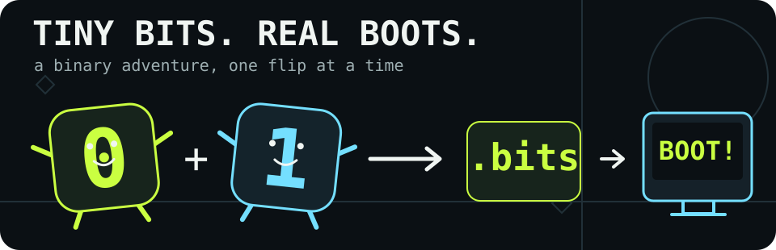
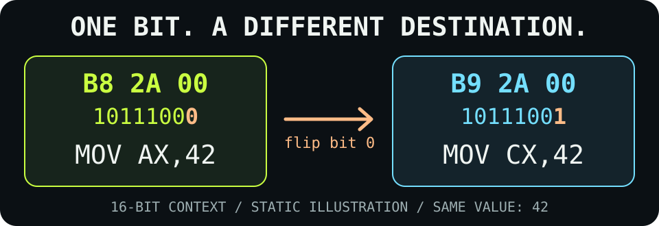

# bitborn

### 🧬 Software born from raw bits.

**No C. No Rust. No Assembly. No compiler. Just 0s and 1s.**

[](https://github.com/OthmaneBlial/bitborn/actions/workflows/test.yml)
[](https://github.com/OthmaneBlial/bitborn/actions/workflows/pages.yml)
[](https://github.com/OthmaneBlial/bitborn/releases/latest)
[](LICENSE)

**[🎮 Playground](https://othmaneblial.github.io/bitborn/playground/) ·
[🧠 CPU lab](https://othmaneblial.github.io/bitborn/cpu-lab/) ·
[📚 Docs](https://othmaneblial.github.io/bitborn/docs.html) · [🧭 Roadmap](ROADMAP.md)**

Start with three bytes. Flip one bit. Watch the instruction change.
Then boot a real **512-byte BIOS image** written directly as binary digits.

Every opcode, operand and branch displacement is authored in `.bits` files.
The packer preserves those bytes; no assembler chooses them for us. Around that
small beginning are **21 examples, 22 challenges, a boot builder and a visual CPU
lab** for following the machine one instruction at a time.


*A real QEMU/SeaBIOS boot. [Capture provenance](assets/boot-recording.json).*

## 🎮 Pick your first adventure

| Try this | What you get to change |
| --- | --- |
| [Flip an instruction bit](https://othmaneblial.github.io/bitborn/playground/) | A register selector, an immediate value or a branch condition |
| [Explore the CPU lab](https://othmaneblial.github.io/bitborn/cpu-lab/) | Registers, flags, stack, memory, breakpoints and recorded Back/Forward |
| [Repair a binary challenge](https://othmaneblial.github.io/bitborn/challenges/) | A few bits, hints and an actual behavior goal |
| [Build a boot sector](https://othmaneblial.github.io/bitborn/boot-builder/) | An editable 512-byte image you can export and boot in QEMU |
| [Peek inside an ELF](https://othmaneblial.github.io/bitborn/elf/) | Real headers and entry-point mapping; inspection only |

New to machine code? Begin with [one byte, one word, one branch](docs/tutorials/byte-order.md),
then follow the [learning path](https://othmaneblial.github.io/bitborn/learn/).

## 🚀 Boot your first image

You need **Python 3.10+, Make and QEMU**.
On macOS: `brew install qemu`. On Ubuntu:
`sudo apt-get install python3 make qemu-system-x86`.

```sh
git clone https://github.com/OthmaneBlial/bitborn.git
cd bitborn
make test
make run
```

`make run` opens the QEMU display and mirrors the greeting to the serial terminal.
`make test` checks real guest behavior headlessly. QEMU TCG also runs these BIOS
examples on Apple Silicon. Linux ELF examples need a **Linux x86-64 kernel**;
macOS skips their native test and Ubuntu CI executes all six.

## 🧭 Where we're headed

Updated **2026-10-13**. **[v0.4.0 is public](https://github.com/OthmaneBlial/bitborn/releases/tag/v0.4.0)**,
with verified downloads, source and checksums. The boot tools, interactive labs,
challenges and one-bit native experiments are working. New [optimization puzzles](docs/tutorials/optimization.md)
measure **14 → 12** and **11 → 10** payload bytes, with distinct valid solutions.
[Keyboard checks](docs/cpu-lab/keyboard.md) cover timeline navigation, imports and
error focus. Native research now includes a guarded allocator, timer interrupt
frames, a [paging write repair](examples/paging/README.md) and
[shared exception frames](examples/exception-dispatch/README.md).
[Bit Hunt](examples/bit-hunt/README.md) adds a native maze, a one-bit victory
control and actual QEMU footage. General recovery and user-mode proof remain next.

**[Read the full roadmap, completed milestones and evidence →](ROADMAP.md)**
The [live roadmap](https://othmaneblial.github.io/bitborn/roadmap/) follows that same
source. We update this summary and the detailed roadmap after verified milestones.

## 🔬 Three bytes, one tiny plot twist

```text
10111000 00101010 00000000
   B8       2A       00
```

In 16-bit mode, those literal bytes mean `MOV AX,42`. Flip the low opcode bit:
B8 becomes B9, and the destination becomes CX. The value stays 42.



The mnemonic explains the bytes; it never generates them. Mode matters:
32-/64-bit inspection has different operand sizes, while browser execution stays
inside its documented 16-bit teaching subset.

## 🧰 Four tools for curious bytes

| Tool | Job |
| --- | --- |
| `bitpack` | Parse literal binary tokens and comments into unchanged bytes |
| `bitinspect` | Read byte tables, checked annotations and declared address references |
| `bitverify` | Check sizes, BIOS signatures and reviewed hashes |
| `bitdiff` | Show changed bytes and individual flipped bits |

Explore [every byte of the boot sector](examples/boot-sector/bytes.md),
the [example gallery](examples/README.md), or the
[architecture guide](docs/architecture/README.md). The collection includes Linux
programs, keyboard/VGA experiments, a disk loader, monitor, shell, protected-mode
research and native one-bit changes to future instructions and palette colors.

## 🌍 Learn in your language

[English](docs/i18n/en/README.md) · [简体中文](docs/i18n/zh-CN/README.md) ·
[Español](docs/i18n/es/README.md) · [Français](docs/i18n/fr/README.md) ·
[日本語](docs/i18n/ja/README.md) · [Português](docs/i18n/pt/README.md) ·
[Deutsch](docs/i18n/de/README.md) · [العربية](docs/i18n/ar/README.md)

These introductions share the same literal example, quickstart and boundaries.
Detailed guides currently use English. [Read the localized website pages →](https://othmaneblial.github.io/bitborn/intro/en/)

## 🧪 The bits have to earn their place

QEMU checks real guest registers, memory and output. Linux CI executes the ELF
examples. Independent encoding/property checks and Chrome, Firefox and WebKit
tests cover the browser tools. Recordings include source and frame provenance.
See the [roadmap evidence](ROADMAP.md), [validation notes](docs/validation.md) and
[reproducible showcase](SHOWCASE.md).

The browser has explicit unsupported-encoding errors, a 4,096-step ceiling and
1 MiB of modeled memory. Native execution and browser simulation are separate
checks. Physical hardware and native UEFI support remain unverified.

<details>
<summary>🛠 Run the browser checks locally</summary>

Follow [the contributor setup](CONTRIBUTING.md) for QEMU and the development-only
NDISASM dependency, then:

```sh
make site-test
npm ci
npx playwright install chromium firefox webkit
npm run test:browser
npm run test:cross-browser
python3 tools/verify_browser_export.py
```

</details>

## 🙋 A few fair questions

**Is this Assembly?** Assembly uses symbolic instructions that an assembler
encodes. Here the literal bytes are the source; instruction names are explanations.

**Is the whole repository binary?** The target instructions and data are.
Packaging, tests, documentation, website and QEMU use ordinary tools and languages.

**Was AI involved?** Yes. Editing, explanations, host tools and the website were
AI-assisted. “Handwritten” means direct authorship of literal instruction bytes,
rather than compiler output; it does not mean unassisted human authorship.

**Is this a production OS or a complete emulator?** It is an educational
experiment with explicit support boundaries. Use a disposable QEMU guest for
native programs. The [execution-scope guide](docs/execution-scope.md) explains
exactly what has been inspected, modeled and executed.

## 🤝 Come make a bit of a difference

Read [CONTRIBUTING.md](CONTRIBUTING.md), pick a
[good first contribution](GOOD_FIRST_ISSUES.md), or reproduce an experiment and
tell us what happened. Small, explained, checked byte changes are welcome.

[Changelog](CHANGELOG.md) · [Code of conduct](CODE_OF_CONDUCT.md) ·
[Security](SECURITY.md) · [License](LICENSE) ·
[Latest release](https://github.com/OthmaneBlial/bitborn/releases/latest)

Created for [OthmaneBlial](https://github.com/OthmaneBlial). Intel, QEMU, SeaBIOS,
Linux and ELF provide the underlying interfaces;
[primary technical references](docs/architecture/README.md#technical-references)
document them. No upstream executable blob is presented as our target source.
