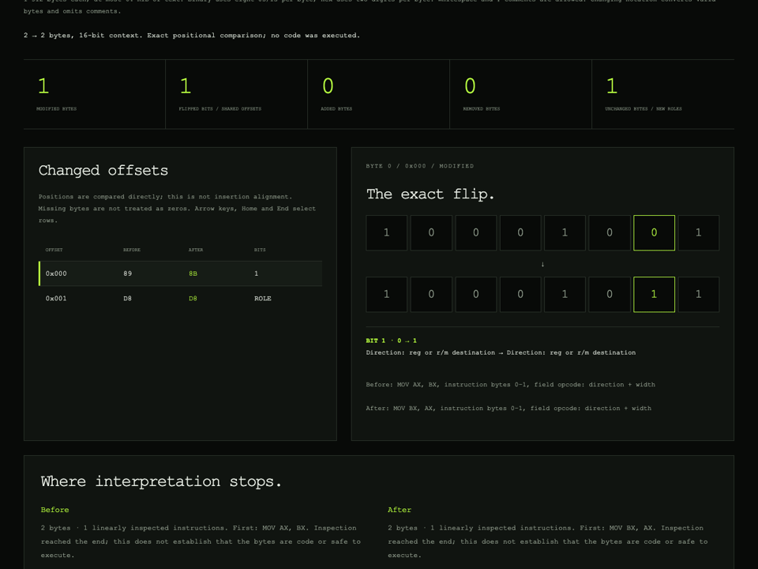
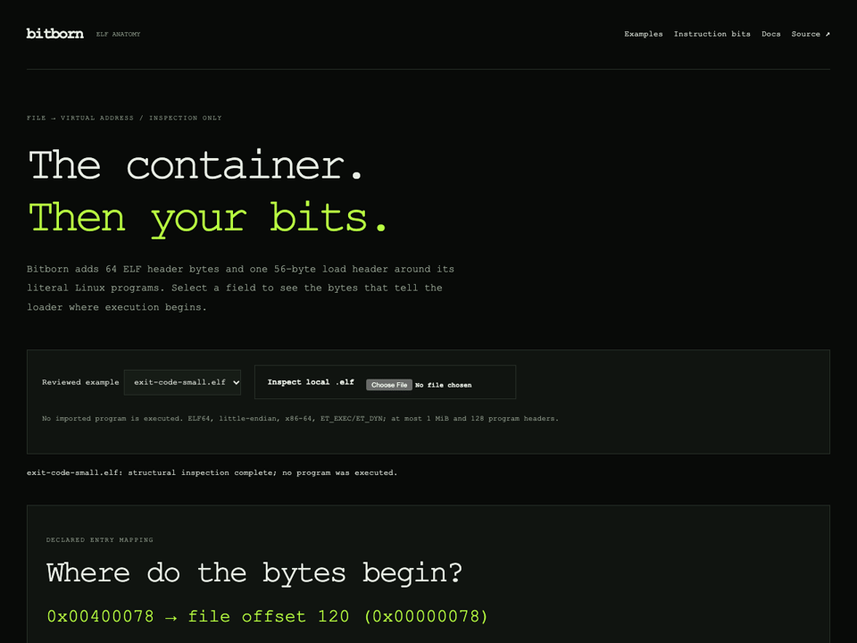
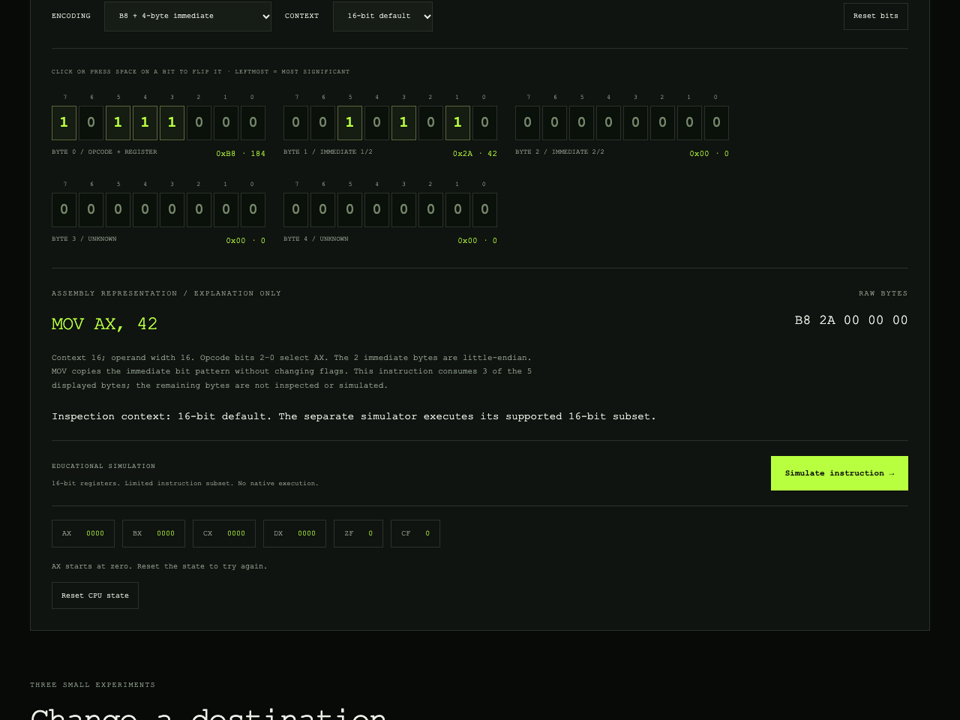
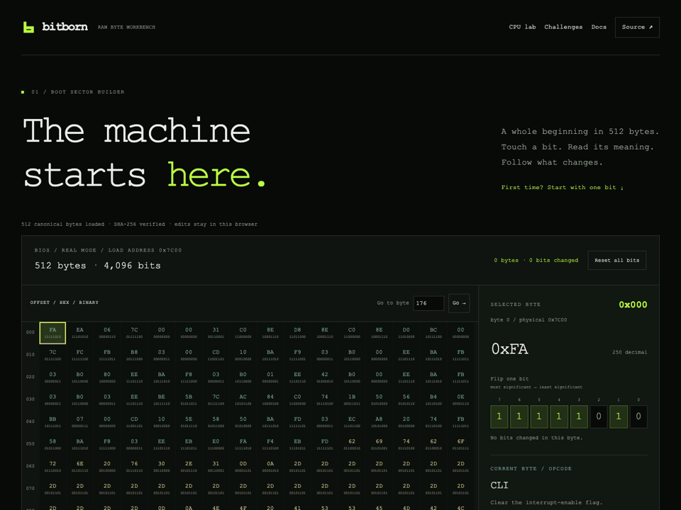
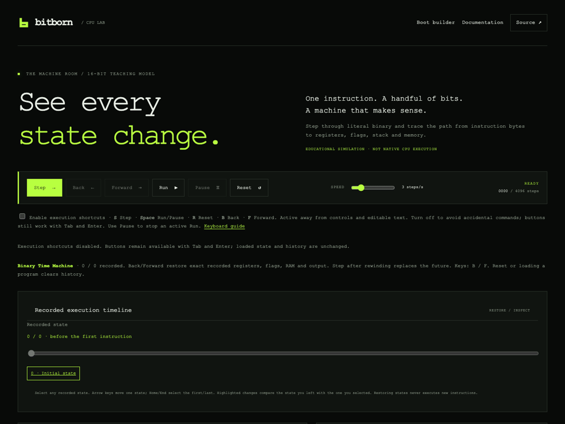
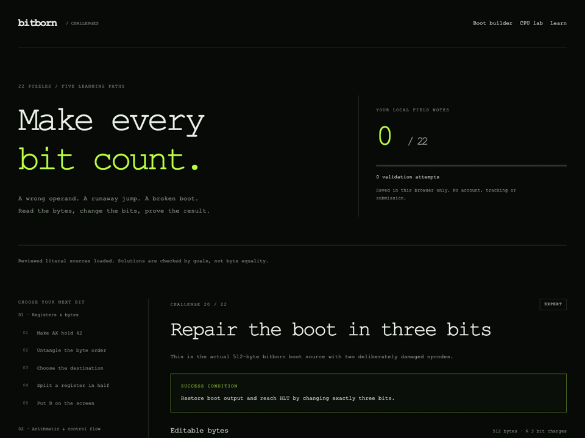
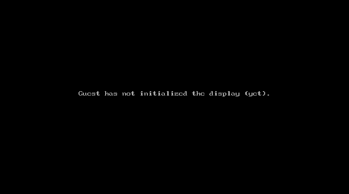

# Make one bit count

## See the sign flag disagree with signed ordering

Open the [CPU Lab](https://othmaneblial.github.io/bitborn/cpu-lab/) and import its
linked [95-byte comparison exercise](docs/instruction-encoding/fixtures/signed-branches.bits).
After eleven steps, SF=0 but OF=1: JL correctly treats -32768 as less than 1.
The second overflowing comparison has SF=1 and OF=1, so JG treats 32767 as greater
than -1. Unsigned branches follow different paths. The same literal bytes pass
native QEMU checks; the [lesson](docs/signed-comparisons.md) gives exact markers.

## Compare a flip with the field it changes



Open the [bit-diff workbench](https://othmaneblial.github.io/bitborn/bit-diff/).
`89 D8` versus `8B D8` changes one opcode bit while reversing six selector-bit
roles in the unchanged D8 byte. Select each row to inspect its exact binary
patterns and role descriptions. The sign-bit pair compares BP-2 with BP+126;
the mode selector exposes instruction boundaries and explicit scope stops.
Added bytes are counted separately from flipped shared bits. This tool performs
no execution, insertion alignment, control-flow analysis or code/data discovery.

## Inspect the container around eight instruction bytes



Open the [ELF explorer](https://othmaneblial.github.io/bitborn/elf/). The reviewed
eight-byte exit program has 120 header bytes followed by its unchanged payload.
Select `PH0.p_flags` to highlight the RX permission bytes, then follow entry
`400078` to file byte 120 (`6A`). Compare the original 12-byte payload: its ELF
container has 132 bytes and the same entry mapping. Use arrows or Home/End to
inspect bytes; no program is executed by this viewer.

The [anatomy guide](docs/elf-anatomy.md) documents scope, checked malformed inputs
and exact address mapping. Actual Linux execution remains separate CI evidence.

These demonstrations are reproducible from the repository. Browser recordings
show real interactions with the bounded JavaScript teaching model. QEMU captures
show guest machine-code execution. Those are separate kinds of evidence.

## Inspect the same bytes in three contexts



Open the [instruction playground](https://othmaneblial.github.io/bitborn/playground/).
Choose the four-byte immediate fixture: 16-bit context reads MOV AX,42 and consumes
three bytes; 32-/64-bit contexts read MOV EAX,42 and consume five. Choose the
`49 B8` fixture in 64-bit mode to inspect R8 and the exact unsigned 64-bit value.
Flip prefix B to select RAX, then W to select EAX and reduce the immediate width.
Change context to see 40–4F interpreted as legacy INC/DEC instead of REX prefixes.

This recording performs inspection only. The simulation button stays disabled
for unsupported contexts. [Literal source and scope](docs/instruction-encoding/fixtures/README.md)
and independent disassembly goldens back the explanations; these checks are
separate from native execution. Capture provenance includes the loaded code,
HTML, CSS, literal fixtures and frame hashes.

## 1. Boot a sector authored directly as bits


**Environment:** legacy BIOS, x86 real mode, QEMU TCG. The canonical
[512-byte source](boot/boot.bits) contains instructions, message bytes, padding
and the `55 AA` disk signature. It prints to VGA and COM1, then reaches HLT.

```sh
make test
make run
```

`make test` checks reviewed bytes and executes the BIOS targets in QEMU.
`make run` opens the boot image and mirrors the greeting to the serial terminal.
Close the QEMU window when finished. Linux ELF execution checks require Linux
x86-64 and are explicitly skipped on other hosts.

Capture provenance: [boot-recording.json](assets/boot-recording.json).
Regenerate the QEMU recording with:

```sh
make build
python3 tools/record_boot.py
```

In the instruction playground, choose **89 D8 / register direction** in 16-bit
context. Flip opcode bit 1: MOV AX,BX becomes MOV BX,AX, and the ModR/M role
labels reverse. Choose **40 88 E0 / REX byte names** in 64-bit context to inspect
MOV AL,SPL; without REX, the **88 E0** fixture selects AH instead. REX.W does not
widen a byte MOV. Unprefixed byte/word forms run in the 16-bit model: first execute
MOV AX,42, then simulate **8B D8** to copy AX to BX without changing flags.
Wider/prefixed execution remains unavailable; unprefixed 16-bit-addressed byte/word
memory MOV is supported in the model.
Memory inspection is available in 16-bit context: **8B 46 FE / BP and SS** shows
BP-2 selecting SS; flipping displacement bit7 changes it to BP+126. **8B 08**
shows BX+SI selecting DS, and **8B 16 20 00** selects an absolute offset in DS
rather than BP. Inspection itself reads no RAM; simulation uses the current model
registers and bounded memory. The CPU Lab's **BP, DS and SS** preset initializes
different DS/SS words, reads and stores them, and exposes exact RAM undo/replay.

## 2. Change H to h by flipping one bit



**Environment:** [Boot Sector Builder](https://othmaneblial.github.io/bitborn/boot-builder/),
bounded browser simulation, followed by separate QEMU execution of the export.

1. Go to byte **176**, hexadecimal offset `0x0B0`.
2. Flip **bit 5**, the third bit from the left. Its MSB-based control index is
   **2**: `01001000` (`H`, `0x48`) becomes `01101000` (`h`, `0x68`).
3. Run to halt. Find `hello from raw machine code!` in the simulated screen and
   serial output. The instruction bytes remain unchanged.
4. Download the `.img` and literal `.bits` source. The image must still contain
   exactly 512 bytes with `55 AA` at offsets 510–511.

The real-browser regression check saves these exact downloads as
`build/builder-edited.img` and `build/builder-edited.bits`:

```sh
make site-test
npm ci
npx playwright install chromium
node tests/browser_builder.mjs
./tools/bitpack build/builder-edited.bits build/builder-repacked.img
./tools/bitdiff build/builder-edited.img build/builder-repacked.img
./tools/bitverify build/builder-edited.img --size 512 --bios
qemu-system-i386 -machine pc,accel=tcg -drive file=build/builder-edited.img,format=raw,if=floppy -boot a -serial stdio
```

The byte diff should report `identical`. Framing checks establish size and
signature; only the separate QEMU run checks this export's guest behavior.
The browser simulation alone does not establish native boot correctness.

For an installed local Chrome, set `PLAYWRIGHT_CHROMIUM_EXECUTABLE` to its
executable path instead of installing Playwright's Chromium.

## 3. Watch the stack and flags change



**Environment:** [CPU lab](https://othmaneblial.github.io/bitborn/cpu-lab/),
bounded 16-bit teaching model. The literal preset sources live in
[presets.mjs](site/cpu-lab/presets.mjs); their mnemonics explain those bytes.

- Select **Stack, CALL & RET**. Step the first MOV and PUSH. AX holds `1234`,
  SP moves from `7C00` to `7BFE`, and the memory inspector shows `34 12` at
  physical addresses `7BFE` and `7BFF`. Continue to observe POP, CALL and RET.
- Use the recorded timeline: Home restores the initial state and previously
  written stack bytes; End restores the recorded final state, including HLT.
  Arrow keys move one recorded state. Back/Forward work one state at a time.
  Register bits and RAM highlights compare the displayed states. Step after a
  rewind discards the old future; restoring history does not execute instructions.
- Export loaded `.bits` or raw `.bin`, then import it and run the same model program.
  The downloads preserve original loaded bytes, before self-modification; comments
  and pending editor drafts are omitted. Export does not change the recorded state.
  Raw downloads have no BIOS framing or ELF headers and are not automatically bootable.
- Select **BP, DS and SS**. After initialization, BP-2 reads `2233` from SS while
  BX+SI reads `1111` from DS at the same effective offset. The word store at
  physical `10030` writes `11 11`; rewind restores zeros and replay restores both
  bytes. A later high-byte store/low-byte load produces DX=`1122`. The identical
  canonical 71-byte program also passes curated native QEMU state/RAM/flag checks.
- Edit a valid binary draft and inspect the equivalent hex view: binary comments
  remain intact, and the loaded machine keeps its recorded state. Edit hex byte
  tokens, then choose **Load hex & reset** to replace source notation/comments
  and reset. This converts literal byte notation; it does not assemble names.
- Select **Arithmetic & flags**. Step the first MOV and ADD. `FFFF + 1` wraps
  AX to zero and sets CF and ZF. The following INC preserves carry.
- Choose **Copy program link** or use the selectable URL. The link contains
  1–512 original loaded bytes, excluding drafts, comments and execution history.
  Open it to get the same bytes in a ready-to-step state. The recorded demo uses
  `B8 07 00 F4`; opening the link executes zero instructions. Invalid links keep
  the current model state. Clipboard denial leaves the URL available to copy.
- Select **Follow a branch**. Set a breakpoint before the loop body, run, then
  step the branch and follow the instruction-pointer transfer.

Reproduce the model and UI checks:

```sh
node tests/test_cpu.mjs
node tests/test_cpu_lab.mjs
node tests/browser_cpu_lab.mjs
```

The lab exposes its supported subset and a 4,096-step execution limit. It does
not implement a complete CPU or BIOS. Independently checked CPU fixtures also
have a [real QEMU contract test](tests/test_cpu_contract.py).

## 4. Repair a boot sector in exactly three bits



**Environment:** [20 binary challenges](https://othmaneblial.github.io/bitborn/challenges/),
five each at beginner, intermediate, advanced and expert level. Goals, locked
bytes, edit budgets, negative starting programs and reviewed solutions are
deterministic. Completion progress stays in this browser's local storage.

Open [Repair the boot in three bits](https://othmaneblial.github.io/bitborn/challenges/?id=repair-boot).
Restore the far-jump opcode and forward string direction without exceeding the
three-bit budget, then choose **Run & validate**. Inspect the canonical
[starting source](challenges/repair-boot/start.bits) and
[reviewed solution](challenges/repair-boot/solution.bits).

<details>
<summary>Show the three-bit repair</summary>

| Byte offset | Starting binary | Repaired binary | Mechanism |
| --- | --- | --- | --- |
| 1 / `0x001` | `11101011` | `11101010` | Restore `EA`, the far-jump opcode |
| 17 / `0x011` | `11111111` | `11111100` | Restore `FC`, CLD, by changing two bits |

The reviewed solution is byte-identical to `boot/boot.bits`. The browser checks
the edit budget and modeled output; the curated solutions also have actual
QEMU execution tests. Arbitrary user edits are not executed on the host.

</details>

```sh
node tests/test_challenges.mjs
node tests/browser_challenges.mjs
python3 -m unittest tests.test_challenges -v
```

## 5. Enter 32-bit protected mode and return from an interrupt



**Environment:** actual QEMU x86 guest execution. The loader enters in BIOS
real mode; the [568-byte literal stage](examples/protected-mode/program.bits)
installs a GDT, sets CR0.PE, and far-jumps into code with 32-bit defaults. It
stores `11223344` in actual RAM, reads it back, and calls a software interrupt
through its IDT gate. The handler writes `C0DEC0DE`; IRETD restores the saved
instruction pointer, code selector, flags and stack pointer before the success
path prints green `PM` in VGA and halts.

```sh
make build
qemu-system-i386 -machine pc,accel=tcg -drive file=build/protected-mode.img,format=raw,if=floppy -boot a
python3 -m unittest tests.test_protected_mode -v
```

The native tests check CR0.PE, CS32, segment selectors, RAM readback, the
interrupt frame and return, VGA bytes, and the controlled failure path.
The browser's bounded 16-bit model does not run this stage. There is no paging,
user mode, exception handler, external interrupt driver or complete OS claim.

[Still QEMU capture](assets/protected-mode-demo.png) ·
[Exact byte layout and limits](examples/protected-mode/README.md)

## 6. Run a disk-loaded app and return to a binary shell


**Environment:** actual QEMU BIOS real-mode execution. The five-sector disk
contains the existing handwritten loader, an
[813-byte shell](examples/shell/program.bits), and a separately authored
[150-byte app](examples/shell-app/program.bits). The shell provides nine exact
lowercase commands with bounded input editing; the app is not independently
bootable.

```sh
make build
qemu-system-i386 -machine pc,accel=tcg -drive file=build/shell.img,format=raw,if=floppy -boot a -serial stdio
```

Focus the guest's QEMU display and type these commands, each followed by Enter:

```text
help
write
read
dump
regs
run
dump
```

`write` stores the fixed byte `2A` at physical `0600`; `read` and `dump` inspect
actual RAM. `regs` samples eight general registers, four segments and FLAGS
into RAM before printing those words. `run` reads disk sectors 4–5 into
`0000:9000`, checks BIOS carry, and calls the separate app. It computes seven
additions of six, stores the computed `2A` at `0601`, prints the result, and
RETs to the shell prompt. The second `dump` shows both RAM experiments.

```sh
python3 -m unittest tests.test_shell -v
```

The native tests cover every command, actual register and memory sampling,
keyboard bounds and Backspace, exact matching, disk bytes, repeated app returns,
and the actual BIOS disk-error path. The fixed RAM window and sector layout are
educational limits; this is not a filesystem or general application loader.

[Still QEMU capture](assets/shell-demo.png) ·
[Shell commands and layout](examples/shell/README.md) ·
[App calling convention](examples/shell-app/README.md)

Regenerate both native guest recordings:

```sh
make build
python3 tools/record_system.py
```

## Capture and verification records

- [QEMU capture provenance](assets/boot-recording.json): source image hash,
  emulator version, frame counts and reproduction command.
- [Browser capture provenance](assets/browser-demo-recording.json): actual
  browser actions, input bytes and recording conditions.
- [Protected-mode and shell capture provenance](assets/system-recording.json):
  actual QEMU frame captures, source hashes, emulator conditions and the
  reproduction command. These native guest captures are separate from the
  bounded browser-model recordings.
- [Validation method](docs/validation.md), [architecture](docs/architecture/README.md)
  and [current roadmap](ROADMAP.md) separate packaging, simulated behavior,
  QEMU/native execution and publication evidence.

Regenerate the browser recordings with FFmpeg and FFprobe installed:

```sh
make site-test
npm ci
npx playwright install chromium
npm run record:browser
```

GIFs demonstrate observed interactions; they are not performance benchmarks.
No hardware, UEFI, complete operating-system or popularity claim follows from
these recordings. Target encodings were authored directly as literal binary
digits with AI-assisted editing; host tools and the website use ordinary code.
