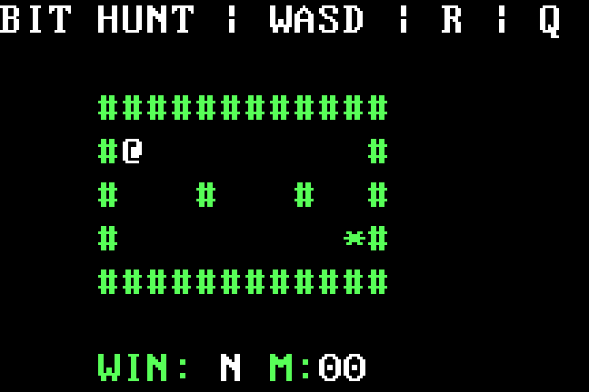

# Bit Hunt: a star inside 492 bytes

This native experiment is a tiny BIOS text-mode maze. Move the white `@`
with **W/A/S/D**, reach `*`, restart with **R**, and quit with **Q**. Walls block
movement. `WIN: Y` stays set after collecting the star until restart; `M` shows
successful moves in hexadecimal and saturates at FF. Upper/lower ASCII letters
share one comparison path.

The [492-byte source](program.bits) is directly authored binary, including the
fixed map, control legend and hexadecimal glyphs. Host packaging adds zero fill
and the 55 AA signature to produce a 512-byte BIOS image.
[Every byte explained](bytes.md). Build the primary image with `make build`, then
run `qemu-system-i386 -drive file=build/bit-hunt.img,format=raw,if=floppy -boot a`.
Run the native proof with:

```sh
python3 -m unittest tests.test_bit_hunt -v
```

An independent coordinate oracle drives actual QEMU keyboard input. Tests check
all sixty VGA cells and attributes, the title and status, collisions, unknown
keys, a complete route, sticky victory, restart and deliberate quit. A separate
260-move run checks saturation and display/state integrity. Instructions, map,
read-only image and both state guards remain unchanged.

The [one-bit control](no-star.bits) changes byte 155, bit 4: the goal predicate
matches colon (3A) instead of star (2A). The map contains no colon. The player
can follow the same route and stand on the same star, but `WIN` remains N.
This control changes a literal instruction operand; no runtime code is generated.

## State and display

| Location | Meaning |
| --- | --- |
| 1FFF | A5 lower guard |
| 2000–2001 | Player map index, initially 13 |
| 2002 | Saturating successful-move count |
| 2003 | Initialized spare byte |
| 2004 | Sticky win flag |
| 2005 | Initialized spare byte |
| 2006–2007 | Processed-key counter, intentionally modulo 65536 |
| 2008 | 5A upper guard |

The literal twelve-column, five-row map occupies source offsets 392–451. Every
candidate is checked against the sixty-byte bound before accessing map RAM,
then rejected if it is a wall. Reset clears position/moves/win while keeping the
processed-key counter. That counter is diagnostic and never indexes memory.
QEMU tests inspect actual VGA RAM at B8000; the player is an overlay and does
not rewrite the immutable map.

The game initializes mode 3 through BIOS INT 10 and reads keys through INT 16.
Firmware keyboard interrupts are enabled during play. Quit masks interrupts,
sets AX=BEEF and halts at source offset 180 with SS:SP=0000:7C00. Input strings
in the host test are deterministic; they are sent as real QEMU key events.
The proof is for QEMU BIOS `pc`, not physical hardware or browser keyboard/game
emulation.
Both 492-byte payloads fit the CPU lab import bound, but the bounded model stops
atomically at the first C6 memory store at offset 31 after fourteen setup steps.
That setup boundary does not simulate keyboard play or the native game. Verify
it with `node tests/test_bit_hunt_scope.mjs`.

## Actual native recording



The [capture record](../../assets/bit-hunt-recording.json) describes twenty actual
screens from two separate boots, using identical deterministic key sequences.
The native 720×400 screen is cropped to 216×144 at 270,48 and enlarged by three
with nearest-neighbor scaling. Every decoded GIF pixel matches a captured frame;
there are no synthetic pixels, overlays or inferred intermediate states. Pacing
is one second per selected state for explanation, not a latency measurement.
The record includes actual state bytes, VGA/source-RAM hashes, source/image/frame
hashes and full-screen captures of each variant at the goal. Regenerate it with
`python3 tools/record_bit_hunt.py`; raw PPM/PNG frames remain in `build/bit-hunt-recording/`.
