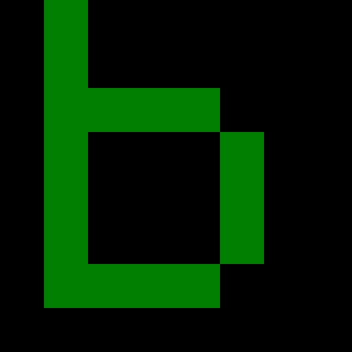

# One palette bit, sixteen native pixels



This **142-byte handwritten payload** draws an 8 by 8 lowercase `b` in native
VGA graphics mode. There are 78 instruction bytes and 64 manually authored pixel
indices. No image importer, assembler or compiler chooses those bytes.

The two literal sources differ only at **byte 41, bit 5** (mask `0x20`, counting
from the least-significant bit as bit zero):

| Source | Green DAC operand | QEMU-captured RGB for index ten |
| --- | --- | --- |
| [program.bits](program.bits) | `00111111` = 63 | `0, 255, 0` |
| [control.bits](control.bits) | `00011111` = 31 | `0, 127, 0` |

The one-bit change leaves all **64,000 framebuffer indices identical**. Sixteen
logical pixels use index ten, so the changed palette component recolors all of
them. Pixel data and code in guest RAM stay unchanged. This is indexed color:
the byte stored for a pixel identifies a palette entry, rather than containing
its red/green/blue channels.

## Run the reviewed image

```sh
make build
qemu-system-i386 -machine pc,accel=tcg \
  -drive file=build/vga-bitmap.img,format=raw,if=floppy,readonly=on \
  -boot a
```

The logical letter is deliberately only eight pixels wide. The GIF crops the
actual captured letter and scales it with nearest-neighbor sampling to 512 by
512. It alternates **two separate boots**, not a live native palette animation.
Full unaltered screen captures are retained as
[program PNG](../../assets/vga-bitmap-program.png) and
[control PNG](../../assets/vga-bitmap-control.png). The
[capture record](../../assets/vga-bitmap-recording.json) identifies source,
payload/image, whole-framebuffer, original PPM, PNG, crop and GIF hashes.

The primary program is a reviewed target, distributed as `vga-bitmap.bin` and a
512-byte signed `vga-bitmap.img`. The separate control is a human-readable native
test fixture; it is not a second reviewed download artifact.

## Follow the literal addresses

The source initializes its own `SS:SP` before calling `INT 10h`, selects mode
`13h`, and restores a known `DS`. It explicitly sets palette entry zero to black
and entry ten to `0,63,0` or `0,31,0`. The VGA write-index port is `03C8`; its
component-data port is `03C9`, accepting red, green and blue in sequence.
[QEMU port definitions and writes](https://github.com/qemu/qemu/blob/master/hw/display/vga.c)
and [register constants](https://github.com/qemu/qemu/blob/master/hw/display/vga_regs.h)
document that interface.

`ES=A000` addresses the packed framebuffer. The first destination offset is
`789C`: row 96 times 320 plus column 156. `SI=7C4E` points to the literal bitmap
at source offset 78. Each row copies eight bytes with `REP MOVSB`, then adds 312
to the destination so the next row begins 320 bytes later. `BL` counts eight
rows; `JNZ -13` at offset 72 returns from next offset 74 to loop offset 61.

The eight authored rows are:

```text
01000000
01000000
01111000
01000100
01000100
01000100
01111000
00000000
```

Here a `1` describes pixel index ten and a `0` describes index zero; this diagram
explains the already authored bytes. It is not input to a pixel/code generator.
The [byte table](bytes.md) covers every one of the 142 payload bytes.

[SeaBIOS's mode table](https://github.com/coreboot/seabios/blob/master/vgasrc/stdvgamodes.c)
defines mode `13h` as packed 320 by 200, eight-bit pixels.
[QEMU's six-to-eight-bit conversion](https://github.com/qemu/qemu/blob/master/hw/display/vga_int.h)
replicates bit zero into the two low bits; the actual captures verify green
components 255 and 127. This is a tested QEMU rendering result, rather than a
claim about physical-display brightness or gamma.

## Reproduce native proof and captures

```sh
python3 -m unittest tests.test_vga_bitmap -v
node tests/test_vga_bitmap_scope.mjs
python3 tools/record_vga_bitmap.py
```

The native test checks the one-bit source difference, initialized registers,
row-loop bounds, all 64,000 framebuffer bytes, every RGB pixel in the QEMU screen
dump, unchanged code/bitmap RAM and unchanged read-only disk/source. The capture
tool additionally verifies that the two-frame GIF decodes to the exact cropped
screen pixels; it never draws a substitute glyph.

The browser CPU model represents selected text-mode BIOS behavior. It rejects
this program's graphics-mode request after the six setup instructions; it does
not draw a pretend bitmap. `REP MOVSB` and VGA palette ports are also outside
that teaching model. Physical hardware and UEFI remain unverified.

The [literal reference map](references.json) checks the bitmap source pointer,
row branch and entry/halt paths for both palette controls. Run
`./tools/bitinspect build/vga-bitmap.bin --references examples/vga-bitmap/references.json`.
The [reference guide](../../docs/address-references.md) distinguishes these
code/data addresses from external VGA memory and port behavior.
